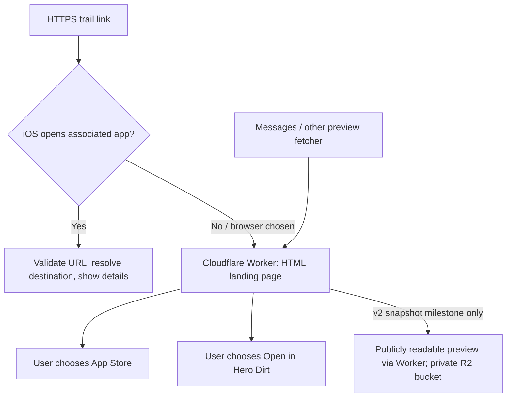

# Cloudflare universal links — deferred v2 implementation plan

Status: **planned, not implemented or deployed**. Updated October 24, 2026.

The current product decision is to share the generated condition image as an actual attachment plus `https://apps.apple.com/app/id6770195112`. Keep that v1 behavior until demand justifies this project. This document preserves the requested detailed plan so Cloudflare and iOS development can proceed in parallel later. It does not authorize creating billable resources, publishing snapshots, or transmitting app data to Cloudflare now.

## 1. Goals and scope

A single HTTPS link should open the selected destination in an installed Hero Dirt app. When the app does not open, the browser should provide a useful fallback with an App Store button. Messages and other clients should be able to fetch public HTML metadata and a condition image without running JavaScript.

Preserve the existing destination contract:

- Apple Maps place ID available: the destination query contains only `placeID`.
- No place ID: use `lat`, `lon`, and `name`.
- Never expose the private UUID of a saved `Place`, iCloud identifiers, the sender's starting location, or account information.
- Opening a link does not automatically save a trail.
- Continue accepting previously shared `herodirt://trail?...` links.

Do not add advertising attribution, install fingerprinting, referral tracking, accounts, trail recommendations, or another weather/soil calculation engine. Remembering the original trail automatically after a new installation is **deferred deep linking**, a separate future project. Initially, users can tap the original link again after installation.

There are two distinct milestones:

1. **Routing:** universal links, a browser landing page, and a generic Hero Dirt preview. This can be stateless.
2. **Condition snapshots:** publicly hosted, dated condition images and per-share metadata. This requires publication/storage and additional product/privacy decisions. Routing alone does not reproduce the generated condition card in a delivered message.

## 2. Baseline in this repository

| Item | Existing value or implementation |
| --- | --- |
| Bundle identifier | `com.herodirt.app` |
| Configured development team | `K3CQQKBR25` |
| App Store ID | `6770195112` |
| App Store URL | `https://apps.apple.com/app/id6770195112` |
| Legacy link/parser | `HeroDirt/Models/SharedTrail.swift` |
| Apple place resolution | `LiveSharedTrailResolver`, using `MKMapItemRequest` |
| Entry point | `ContentView.swift` receives URLs; `TrailsHomeView.swift` resolves and presents destinations |
| Image generation/share sheet | `PlaceDetailsView.swift` and `TrailSharingView.swift` |
| Project/entitlements source | `project.yml`; generated `HeroDirt/HeroDirt.entitlements` |
| Tests | `PlaceTests.swift` and `TrailDetailsTests.swift` |

The configured team suggests `K3CQQKBR25.com.herodirt.app` as the application identifier, but **verify the signed Release app's `application-identifier` entitlement** before publishing AASA. An App ID prefix is not always the team ID.

No production domain, Cloudflare account/project, storage bucket, or deployment credential has been selected. Use `SHARE_HOST` as a configuration placeholder; do not publish an invented domain or ship a temporary host in Release entitlements.

## 3. Recommended architecture

Use a small **TypeScript Cloudflare Worker with Static Assets**. Earlier discussion mentioned Pages; a Worker with assets is preferable once dynamic HTML and optional snapshot endpoints are required. A React app or client-rendered SPA is unnecessary.



The server does not receive a trustworthy installed-app flag. iOS performs universal-link routing; a browser request can also come from a user who has the app but prefers the website. Do not infer installation from a user-agent string or use custom-scheme timeout tricks as a reliable detector.

Recommended fallback: return an HTML preview page with **Open in Hero Dirt** and **Download on the App Store** actions. Do not unconditionally redirect the share URL to the store: that can replace the useful trail preview with a store preview. If immediate App Store redirection is still wanted, decide that explicitly and test its effect on previews and browser preferences. The `/download` action itself can issue a redirect to the fixed App Store URL.

## 4. URL and response contract — agree before parallel work

Example URLs below use a placeholder host, not a registered domain:

```text
https://SHARE_HOST/trail?placeID=I...
https://SHARE_HOST/trail?lat=37.123&lon=-122.456&name=Example%20Trail

# Optional condition-snapshot milestone:
https://SHARE_HOST/s/<public-snapshot-token>?placeID=I...
https://SHARE_HOST/s/<public-snapshot-token>?lat=37.123&lon=-122.456&name=Example%20Trail
```

The snapshot token identifies an immutable public preview, not a saved trail or person. The destination query remains ID-only whenever an Apple Maps ID is available. The added `/s/<token>` path is a proposed extension that must be approved before implementing snapshot sharing; it avoids adding coordinates/name to an ID-based link.

| Route | Response/behavior |
| --- | --- |
| `GET /.well-known/apple-app-site-association` | Public JSON, 200, no redirect, authentication, challenge, or HTML wrapper |
| `GET /apple-app-site-association` | Optional compatibility endpoint serving the same JSON directly |
| `GET /trail?...` | Validate destination; return server-rendered HTML with generic Hero Dirt metadata |
| `GET /s/<token>?...` | Snapshot milestone: verify token/destination match, render dated snapshot and metadata |
| `GET /images/<token>.jpg` | Snapshot milestone: validated JPEG bytes with correct MIME type; no signed URL expiry |
| `GET /download` | Redirect only to the fixed App Store URL |
| `GET /health` | Minimal availability/version response; no secrets or user data |
| `POST /api/shares` | Snapshot milestone only; controlled publication of image and metadata |

Parsing rules must be shared through fixtures consumed by Swift and TypeScript:

- HTTPS only for new web links; exact configured host, no credentials or unexpected port.
- Match `/trail` exactly, or the approved `/s/<token>` path. Never route arbitrary paths into the app.
- One non-empty, bounded place ID, or finite latitude/longitude in `[-90, 90]` / `[-180, 180]`.
- Reject duplicate destination fields and mixed place-ID/coordinate payloads. Bound overall URL size and name length; encode values using URL components, not concatenation.
- Outbound coordinate links include the name. Incoming name omission can use `Shared Trail`, matching existing legacy behavior.
- Unknown fields, Unicode/emoji names, malformed escaping, empty values, and oversized IDs require explicit contract fixtures rather than different platform guesses.
- The Worker cannot fully validate an opaque Apple ID without Apple lookup. Perform structural checks; let the app's existing MapKit resolver report unavailable places. Do not add server-side Apple credentials just to render the routing MVP.

Return a helpful 400 page for invalid destination URLs, a normal 404 for unknown routes, and never forward arbitrary `redirect`, `next`, or image-fetch URLs supplied by a client.

## 5. Apple association and iOS integration

Generate AASA from checked configuration. An illustrative template is:

```json
{
  "applinks": {
    "details": [
      {
        "appIDs": ["<VERIFIED_APPLICATION_IDENTIFIER>"],
        "components": [
          { "/": "/trail" },
          { "/": "/s/*" }
        ]
      }
    ]
  }
}
```

Do not deploy the placeholder. Include `/s/*` only when that milestone ships. Limit association to intended public destinations; API and image routes should not open the app. Serve JSON over valid HTTPS without redirects. Apple's association CDN has its own caching behavior; changing local headers is not an immediate invalidation mechanism. Use Apple's documented developer mode for controlled debug testing, never as the Release configuration.

iOS tasks:

1. Add `applinks:SHARE_HOST` through `project.yml` and verify the generated entitlements and signed Release product. Keep iCloud/WeatherKit entitlements and normal simulator signing intact.
2. Extend `SharedTrail` to accept only the selected HTTPS host/routes as well as the existing custom scheme. Keep one destination parser and the current ID-first/fallback representation.
3. Route universal-link user activities (`NSUserActivityTypeBrowsingWeb`) and existing `.onOpenURL` events through one handler in `ContentView`. Avoid duplicate navigation for the same delivery while allowing deliberate later taps on the same URL.
4. Reuse the asynchronous resolver, loading UI, and errors in `TrailsHomeView`. Cancel obsolete requests and ignore stale results if a newer link arrives. An unresolved ID must not become `(0, 0)` or save anything.
5. Keep v1 image-plus-store sharing until production association and device tests pass. Introduce an explicit configuration/rollout switch for HTTPS sharing; no staging host should leak into Release output.
6. For optional snapshots, create the public link before presenting the system share sheet. Show progress/cancel/retry; fall back to v1 if offline or publication fails. Never perform uploads or image compression inside `UIActivityItemSource` callbacks or during menu opening.

## 6. Browser landing page and preview metadata

Routing MVP:

- Return usable HTML in the initial GET response, not JavaScript-only content.
- Provide `og:title`, `og:description`, `og:image`, `og:url`, an ordinary title, image dimensions/type, and optional Twitter card metadata. Escape all user text and attributes.
- Use absolute HTTPS image URLs. A crawler must receive the image directly with 200 and the correct content type, without cookies, login, bot challenges, or client-side execution.
- An ID-only link does not contain a trail name, condition, or image. Without published snapshot data, use honest generic Hero Dirt branding; do not fabricate trail-specific conditions.
- For coordinate fallback, the supplied name can be shown after escaping, but that still does not provide a condition image.
- Include an accessible app-open action targeting the equivalent legacy `herodirt://trail?...` URL and the fixed download action. This also helps older app builds that support the custom scheme but lack association entitlements.
- Account for dark/light appearance, Dynamic Type/browser text scaling, small screens, VoiceOver, keyboard focus, disabled/unavailable download state before the public listing is live, and desktop visitors.

Snapshot milestone:

- Use the exact immutable snapshot URL for canonical/`og:url` identity; do not collapse every snapshot to `/trail?placeID=...` and invite cross-share preview-cache collisions.
- Label the condition as an estimate **at the shared timestamp**, not live current trail status. Do not refresh an old link's condition silently.
- Start with the existing generated card. Test its portrait composition in Messages; evaluate a dedicated compact social image if cropping obscures the condition or outlook. Do not assume Apple's Maps-specific layout can be reproduced.
- Do not rely on a JavaScript redirect, meta refresh, or locally supplied `LPLinkMetadata` to preserve the delivered preview. The public page must stand alone. Browser and messaging apps retain their own preview policies/caches, so test delivered messages on real devices.

## 7. Optional public snapshots and storage

This is additional scope, not a prerequisite for basic universal-link routing.

Proposed `POST /api/shares` accepts a bounded multipart request: a small versioned JSON envelope and a native-generated JPEG. Metadata contains the destination, display name, condition identifier, shared timestamp, image dimensions, and schema version. Do not upload the user's trail collection, local UUID, precise starting location, account IDs, or raw photo-library files.

Suggested initial bounds: 16 KiB metadata, 1 MiB JPEG, bounded pixel dimensions, a 200-character display name, and an allowlist for the five condition values. Confirm these against real generated cards. Re-encode the generated image without EXIF/location metadata. Reject arbitrary HTML, SVG, remote image URLs, and unsupported media; do not build an unrestricted URL-fetch proxy.

Use a private R2 bucket accessed through Worker bindings. Store immutable image bytes and a JSON manifest under a server-generated unguessable token. Write the manifest last and return 201 only once the share is readable. The response includes the public HTTPS share URL. Do not put storage keys, R2 credentials, or reusable server secrets into the iOS app.

An idempotency key should reuse the same result after an interrupted client retry. Clean up partial writes and orphan images. Bind the manifest to the destination query; changing `placeID` on someone else's snapshot URL must not display a misleading image for a different destination.

Before opening creation to the public, select and implement a bounded abuse-control design: per-request size limits, creation quotas, burst limits, and appropriate app verification. An API secret embedded in the app is not authentication. App Attest-backed verification is an option to evaluate, with simulator/local-test behavior and any nonce/replay storage designed explicitly; it is not an existing app capability or an approved implementation choice yet. Read-only preview URLs must remain publicly fetchable by messaging crawlers.

Publication is a new privacy behavior: Cloudflare would receive and store the selected name, destination, and generated condition image. Make creating a public link a deliberate share action, update `PRIVACY.md` and applicable App Store disclosures, and retain the image-only v1 option. Do not start uploading on place open, refresh, or menu open.

Choose retention before launch. A possible starting policy is 90 days for images, with destination fallback surviving through the URL query even if the snapshot expires. This is a proposal, not a promise of permanent previews. Use R2 lifecycle rules and cleanup jobs as appropriate. Deletion cannot erase copies already cached by messaging apps or recipients.

## 8. Repository layout and environments

Keep the first web implementation alongside the iOS app to share the URL contract:

```text
web/share-links/
  package.json
  package-lock.json
  wrangler.jsonc
  tsconfig.json
  src/index.ts
  src/destination.ts
  src/render-page.ts
  src/config.ts
  src/snapshots.ts          # later milestone
  public/                  # CSS, brand assets, generic preview image
  scripts/generate-aasa.ts
  tests/
  README.md
shared/deep-link-fixtures.json
.github/workflows/share-links.yml
```

Use TypeScript, Wrangler, and a Worker-compatible test runner such as Vitest with Cloudflare's test integration. Pin compatible dependencies and the Worker compatibility date during implementation. Keep generated bindings and build outputs out of the main iOS source tree.

Create independent local, staging, and production configuration. Staging must use separate storage and public test content; never mix it with production snapshots. Choose a stable production custom domain before releasing app entitlements. A temporary `workers.dev` host may help staging but should not become a production dependency accidentally.

Use Static Assets for CSS, the generic image, and generated AASA. Route `/trail`, `/s/*`, and later `/api/shares` through the Worker deliberately. Do not configure a catch-all SPA fallback that returns HTML for AASA or an image. Verify content types and HTTP responses after deployment rather than trusting local routing alone.

Store deployment tokens in GitHub environment secrets with minimum required scope. No secrets in Git, app binaries, fixtures, preview HTML, or logs. Production deployment should be a separate, deliberate step; PR validation must not publish, run destructive migrations, or use production data.

## 9. Parallel workstreams and handoffs

Freeze the route/JSON fixture contract first; then the following lanes can proceed concurrently. This table is a work plan, not a request to start new chats or agents now.

| Lane | Work | Handoff / dependency |
| --- | --- | --- |
| A — Cloudflare routing | Worker scaffold, validation, AASA generation, generic landing/OG page, store action, staging configuration | Publishes a local endpoint contract and staging host once chosen; does not require iOS changes to begin |
| B — iOS integration | Trusted HTTPS parser, universal-link event handling, legacy compatibility, resolver cancellation, guarded outbound URL configuration | Uses shared fixtures and local mock URLs; production entitlement waits for the real host and verified app identifier |
| C — preview design/snapshots | Compact-image experiments, manifest/API schema, R2 read/write adapter and bounded publication design | Only after snapshot scope/privacy approval; can develop against local storage while A/B progress |
| D — QA/release | Contract fixtures, HTTP tests, crawler-shaped requests, physical-device install matrix, cost/logging checks | Starts with fixtures immediately; final delivered-preview tests require public staging and signed app builds |

Integration order:

1. Commit the contract fixtures and configuration placeholders together.
2. Merge/test A's stateless routing and B's inbound support independently; outbound HTTPS sharing remains off.
3. Deploy public staging, verify AASA, then install a staging-associated signed build and run the device matrix.
4. Complete snapshot publication/read paths only if that milestone is approved. Do not hold basic routing hostage to an unfinished upload API.
5. Verify the production host before enabling outbound links. Release app support first, then enable new links; old links and the v1 share option remain usable.

Each lane owns its listed files to reduce merge conflicts. Changes to destination fields, token formats, parsing rules, or failure semantics require updating shared fixtures and coordinating both the Worker and Swift implementations in the same integration cycle.

## 10. Verification and acceptance criteria

Automated checks:

- Swift and TypeScript consume identical valid/invalid destination fixtures, including Unicode names, negative coordinates, duplicate fields, mixed payloads, malformed IDs, unsupported hosts, and malicious HTML names.
- AASA JSON has the verified application identifier, intended paths only, correct MIME type, a direct 200 response, and no authentication/challenge/redirect.
- Share HTML contains title/image metadata in the first response with no JavaScript execution. The canonical URL, app-open URL, and destination agree.
- Image endpoints support the methods needed by preview clients, return real JPEG bytes, and handle invalid/missing/expired tokens consistently.
- Snapshot creation rejects oversized/unsupported input, respects idempotency and quotas, handles partial-write cleanup, and does not overwrite another public snapshot.
- iOS handles new links on cold/warm launch and from map/list screens; failed ID lookup, cancellation, and a newer incoming link cannot show the wrong trail or save it.
- CI runs Worker tests/type checking/build and the existing iOS checks independently. Use synthetic/public test destinations; do not extract real saved trails into external smoke tests.

Physical-device acceptance matrix:

| Scenario | Required result |
| --- | --- |
| Installed app, tap in Messages/Notes | Opens intended destination; cold and warm launches both work |
| App absent | Browser fallback is usable and store action targets `6770195112` |
| App installed but user chooses browser | Useful landing page; no redirect loop or forced incorrect install detection |
| Tap original link after installation | Opens the original destination; no claim of automatic deferred linking |
| Same-domain Safari navigation | Behavior respects Safari's documented preference; explicit app-open fallback is available |
| Place-ID link / coordinate-only link | Correct destination in both cases; ID URL has no redundant name/coordinates |
| Offline / unavailable place ID | Clear error or cached browser content; no fabricated coordinates |
| Share to self and another person | Inspect the **delivered thread** on sender and recipient, not only the composer |
| Reopen/forward/paste link | Preview and destination remain useful without the sender's running app |
| Unreleased App Store listing | Landing page explains availability; do not claim install success |
| Expired/deleted snapshot | Graceful generic destination fallback; no broken app routing or misleading current condition |

The user-observed composer-only preview is the motivating regression. A beautiful share sheet or passing payload unit test is not sufficient to mark delivered previews complete.

## 11. Operations, cost, and rollout

Measure request volume, 5xx/4xx rates, storage, publication failures, image sizes, and latency using aggregate operational metrics. Do not log full destination queries, custom names, image bytes, upload tokens, or sender location. Review Cloudflare's own request-log defaults and retention separately; application log redaction does not imply the provider sees no request data.

Keep routing simple enough for a small Worker. Cloudflare's currently documented free Worker allowance includes 100,000 requests/day and 10 ms CPU/request; recheck before provisioning rather than promising this project is permanently free. Server-side image rendering can exceed that CPU budget, which is another reason to reuse native-generated images for the optional snapshot milestone.

R2 has separate storage and operation costs even though direct egress has no transfer charge. For sizing, 1,000 shares/month at 300 KiB each retained for three months is roughly 900 MiB of image storage, before overhead and cache traffic. Confirm actual billing/limits and set appropriate alerts before enabling services. Worker execution, storage reads, and uploads need separate accounting; a cache hit does not automatically make every Worker invocation free.

Roll out staging first, then production inbound links, then outbound HTTPS sharing behind a configuration switch. Keep the association file and landing service available even if uploads are disabled. Rollback should disable creation/new sharing and return to v1 image-plus-store sharing; do not strand already distributed HTTPS links by deleting their host or AASA configuration.

## 12. Decisions to revisit when v2 starts

1. Which stable domain/subdomain and Cloudflare account should own this? Who controls DNS and production credentials?
2. Is routing with a generic card sufficient for the first milestone, or is an exact dated condition snapshot required before release?
3. Approve the proposed `/s/<token>` path while retaining only the place ID in the destination query when available.
4. Prefer the preview landing page with a download action, or require automatic App Store redirection despite the preview/browser tradeoffs?
5. If publishing snapshots, approve public storage, retention, creation/abuse controls, disclosures, and a monthly spending limit.
6. Does the app's public listing actually become downloadable before links are enabled? Verify availability; an assigned Apple ID alone is insufficient.
7. Is deferred deep linking after installation important enough to consider a managed provider later? It is excluded from this plan's initial implementation.

No answers are required to retain this plan or keep shipping the simplified v1 sharing flow.

## References

Primary documentation checked October 24, 2026; verify current APIs, pricing, and limits when implementation begins.

- [Apple: Supporting associated domains](https://developer.apple.com/documentation/xcode/supporting-associated-domains)
- [Apple: Allowing apps and websites to link to your content](https://developer.apple.com/documentation/xcode/allowing-apps-and-websites-to-link-to-your-content)
- [Apple TN3155: Debugging universal links](https://developer.apple.com/documentation/technotes/tn3155-debugging-universal-links)
- [Apple TN3156: Create rich previews for Messages](https://developer.apple.com/documentation/technotes/tn3156-create-rich-previews-for-messages)
- [Apple DTS: App ID prefix can differ from team ID](https://developer.apple.com/forums/thread/792606)
- [Cloudflare: Workers Static Assets routing](https://developers.cloudflare.com/workers/static-assets/routing/worker-script/)
- [Cloudflare: Worker custom domains](https://developers.cloudflare.com/workers/configuration/routing/custom-domains/)
- [Cloudflare: Worker limits](https://developers.cloudflare.com/workers/platform/limits/)
- [Cloudflare: R2 pricing](https://developers.cloudflare.com/r2/pricing/)
- [Cloudflare: R2 object lifecycle rules](https://developers.cloudflare.com/r2/buckets/object-lifecycles/)
